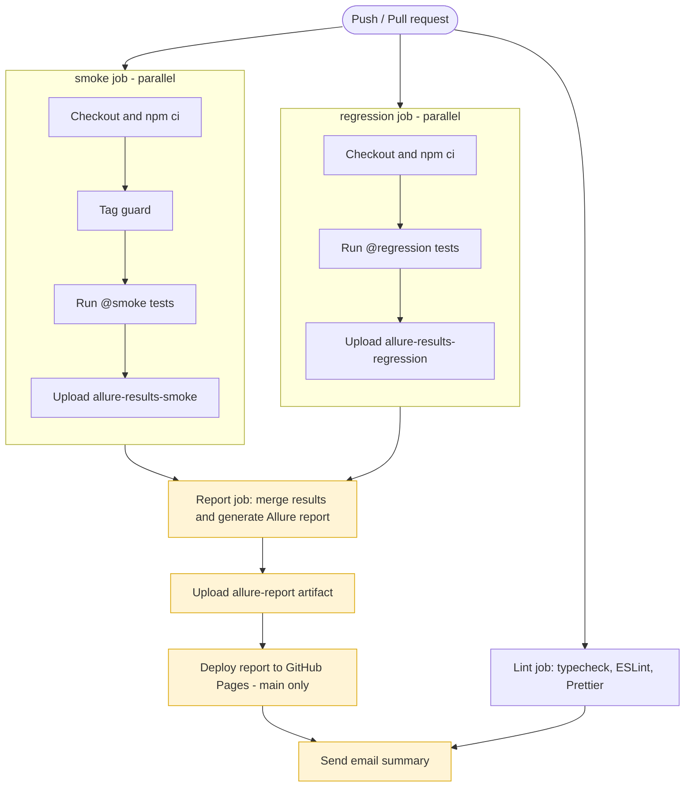

# Playwright TS Framework

A Playwright + TypeScript test automation framework covering **UI** and **API** tests, with Allure reporting and a GitHub Actions pipeline.

## Features

- Page Object Model with fixtures (`fixtures/index.ts`)
- UI and API specs in one suite
- Per-environment config (`dev`, `staging`) selected via `TEST_ENV`
- JSON-driven test data, exported through `test-data/index.ts`
- HTML and Allure reports, with failure screenshots and traces attached
- Static checks: strict TypeScript, ESLint (with Playwright rules) and Prettier, run in CI
- CI on GitHub Actions running inside the official Playwright Docker container (`mcr.microsoft.com/playwright`), so browsers and system dependencies match the pinned Playwright version
- Chromium-only, fully parallel runs

## Prerequisites

- Node.js (LTS)
- Java 17 (only needed to generate the Allure report locally)

## Getting started

```bash
git clone https://github.com/Lahiru66/playwright-ts-framework.git
cd playwright-ts-framework
npm ci
npx playwright install chromium
```

## Running tests

```bash
npm test                                 # run everything
npm run test:smoke                       # smoke suite only
npm run test:regression                  # regression suite only
npm run test:ui                          # only the UI specs
npm run test:api                         # only the API specs
npx playwright test tests/ui/shop.spec.ts  # a single file
npx playwright test --headed             # watch the browser
npx playwright test --debug              # step through with the inspector
```

### Code quality

```bash
npm run typecheck      # TypeScript, strict mode
npm run lint           # ESLint (typescript-eslint + eslint-plugin-playwright)
npm run format:check   # Prettier check (use `npm run format` to fix)
```

CI runs all three in a `lint` job alongside the tests.

### Choosing an environment

The default environment is `dev`. Set `TEST_ENV` to switch:

```bash
TEST_ENV=staging npx playwright test
```

PowerShell:

```powershell
$env:TEST_ENV='staging'; npx playwright test
```

An unknown `TEST_ENV` fails fast and lists the available environments.

## Reports

```bash
npm run report            # HTML report
npm run allure:generate   # Allure report (needs Java)
npm run allure:open
```

Failed tests save a screenshot to `test-results/`, plus a trace when retried; both are attached to the Allure report. In CI they are also uploaded as `failure-evidence-<suite>` artifacts. Open a trace with `npx playwright show-trace <trace.zip>`.

## Project structure

```
.
├── tests/
│   ├── ui/                 # UI specs (page objects via fixtures)
│   └── api/                # API specs (request-based, own test data)
├── pages/                  # Page Object classes
├── fixtures/index.ts       # Extended `test` exposing page objects as fixtures
├── config/
│   ├── env.ts              # Loads the active environment config
│   └── environments/       # dev.json, staging.json (baseUrl, bookingApiUrl)
├── test-data/              # JSON data, re-exported via index.ts
├── playwright.config.ts
└── .github/workflows/      # CI pipeline
```

## Writing tests

- UI specs live in `tests/ui/` and import `test, expect` from `../../fixtures`; API specs live in `tests/api/` and use the `request` fixture (directly or through a client fixture such as `booker`).
- Page objects take `page` in the constructor, expose user-intent methods and contain no assertions. Register each one in `fixtures/index.ts`.
- Use `getByRole` / `getByLabel` / `getByText` locators first; avoid XPath.
- No fixed sleeps (`waitForTimeout`). Rely on auto-waiting and web-first assertions.
- Keep tests independent, since `fullyParallel` is on.
- Put data in `test-data/*.json` and URLs in `config/environments/*.json`. Never hard-code hosts or commit secrets.
- Don't commit `test.only` or `test.skip`; CI sets `forbidOnly`.

## Adding an environment

1. Copy `config/environments/dev.json` to `config/environments/<name>.json` with the same keys.
2. Run with `TEST_ENV=<name>`.

## Continuous integration

`.github/workflows/playwright.yml` runs on every push and pull request. It:

1. Runs typecheck, ESLint and a Prettier check in a `lint` job, in parallel with the tests.
2. Runs the **smoke** and **regression** suites as two parallel jobs, each inside the `mcr.microsoft.com/playwright` container (the tag must match the `@playwright/test` version in `package.json`). A guard step fails the build if any test is missing a `@smoke` or `@regression` tag.
3. Merges both suites' results into one Allure report and uploads it as the `allure-report` artifact (14-day retention).
4. On `main`, publishes the Allure report to GitHub Pages so it can be opened in the browser (see below).
5. Sends an email summary of the run, including the report link.

Required repository secrets for the email step: `SMTP_USERNAME`, `SMTP_PASSWORD`, `TO_EMAIL`.

### Pipeline overview



Both test jobs run inside the Playwright Docker container. Steps in yellow use `if: always()`, so the merged report, artifact, Pages deploy and email happen even when tests fail. The workflow defines five jobs: `lint`, `test` (a matrix that produces the smoke and regression jobs), `report`, `deploy-report` and `notify`. Failed test jobs also upload their screenshots and traces as artifacts.

### Test tags

Every test carries exactly one tag, set with Playwright's `tag` option:

```ts
test('returns a token for valid credentials', { tag: '@smoke' }, async ({ booker }) => { ... });
```

- `@smoke`: fast, critical happy-path checks.
- `@regression`: deeper, negative and edge-case checks.

The two suites run in parallel in CI, so tests must own their data (create it, use it, clean it up) and never rely on data another test creates.

### Viewing the Allure report

- **In the browser (latest `main` run):** https://lahiru66.github.io/Playwright-TS-Framework/
  One-time setup: repo **Settings → Pages → Source: GitHub Actions**. The report is public because the repo is public.
- **Any run (including pull requests):** open the run under the **Actions** tab and download the `allure-report` artifact (kept 14 days), then `npx allure open <folder>`.

## License

See [LICENSE](LICENSE).
